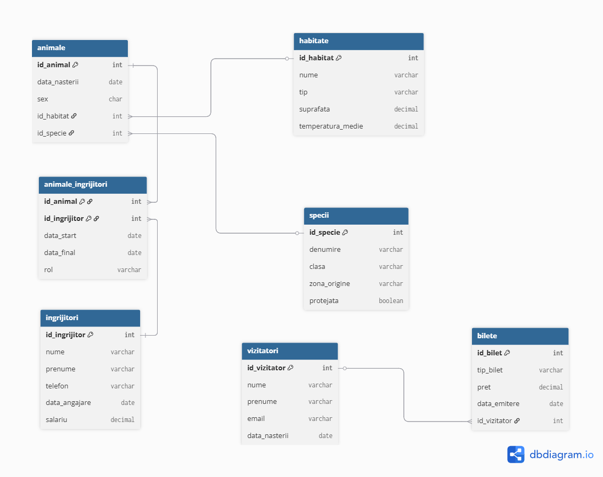

# Zoo Management Database (Oracle SQL & PL/SQL)

Relational database for managing a zoo: animals, species, habitats, caretakers, visitors and tickets.
Built for the *Databases* and *Database Management Systems* courses at the Bucharest University of Economic Studies.

## Data model
7 tables, normalized to **3NF**: `ANIMALE`, `SPECII`, `HABITATE`, `INGRIJITORI`, `ANIMALE_INGRIJITORI`, `VIZITATORI`, `BILETE`.
- many-to-many relationship between animals and caretakers (`ANIMALE_INGRIJITORI`, with role and date range)
- one-to-many relationship between visitors and tickets
- primary keys, foreign keys, `UNIQUE`, `NOT NULL` and `CHECK` constraints

## Contents
| File | Topics |
|---|---|
| `sql/00_schema_data_queries.sql` | DDL (CREATE/ALTER/DROP), sample data, UPDATE, FLASHBACK, joins, single-row & group functions, subqueries, CASE/DECODE, set operators, views, indexes, synonyms, sequences |
| `plsql/01_control_structures.sql` | anonymous blocks, IF/CASE, LOOP/WHILE/FOR, substitution variables |
| `plsql/02_cursors.sql` | implicit cursor attributes (`SQL%ROWCOUNT`, `SQL%NOTFOUND`), explicit and parameterized cursors |
| `plsql/03_exceptions.sql` | predefined and user-defined exceptions, `RAISE_APPLICATION_ERROR` |
| `plsql/04_functions_procedures.sql` | stored procedures and functions (e.g. ticket price updates, revenue per ticket type, visitor spending report) |
| `plsql/05_packages.sql` | grouping the subprograms into packages |
| `plsql/06_triggers.sql` | row-level `BEFORE` triggers enforcing business rules (valid prices, no salary decreases, valid caretaker roles and dates) |

Each exercise starts with a comment describing the requirement (in Romanian).

## Tech stack
Oracle Database · SQL · PL/SQL · SQL Developer
